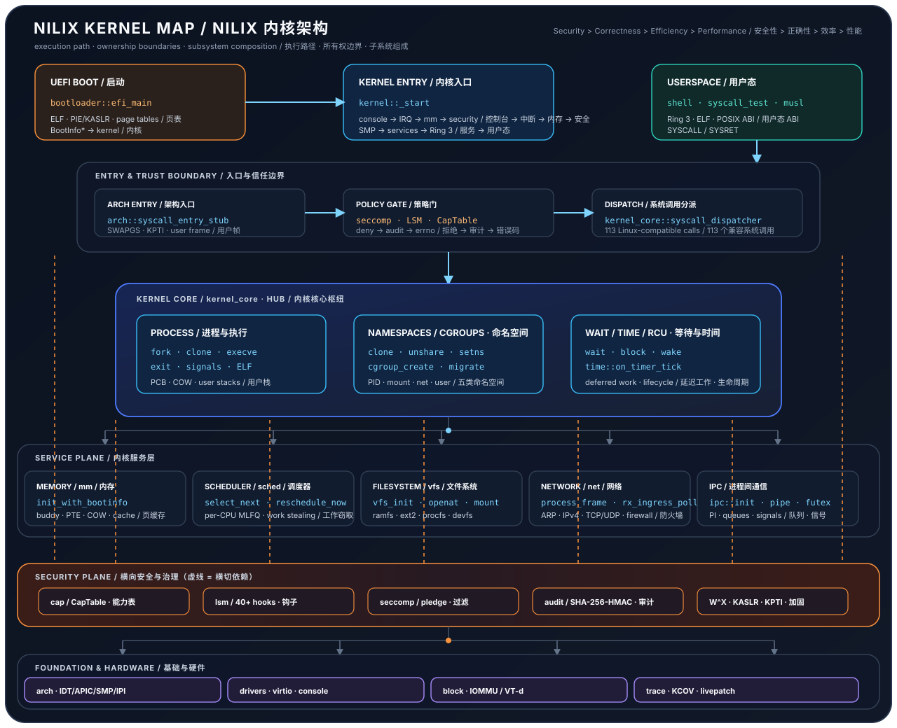

<div align="center">


# Nilix

### 以 Rust 从零编写的实验性 x86_64 内核

**N**ilix **I**s **L**inux **I**ndependent e**X**istence：提供 Linux 系统调用的兼容子集、
capability/LSM 安全框架与 SMP 调度。通过 UEFI 启动，能运行 Ring 3 静态程序和真正的
musl 程序，包括 pthread。

[](https://github.com/Zero-kernel/Nilix/actions/workflows/ci.yml)
[](https://github.com/Zero-kernel/Nilix/actions/workflows/fuzz.yml)
[](rust-toolchain.toml)
[](#快速开始)
[](#当前状态)
[](#许可证)
[](https://github.com/Zero-kernel/Nilix/stargazers)

[English](README.md) · **中文**

**[为什么是 Nilix](#为什么是-nilix) · [当前状态](#当前状态) · [能力一览](#能力一览) · [架构](#架构) · [快速开始](#快速开始) · [测试与 CI](#测试与-ci) · [路线图](#路线图) · [常见问题](#常见问题)**

</div>

---

## 为什么是 Nilix？

Nilix 以“一次验证一个契约”的方式逐步实现 Linux 兼容，始终遵循同一原则：
**Safety > Correctness > Efficiency > Performance（安全 > 正确性 > 效率 > 性能）**。
它不是 Linux 的派生版本；Linux 兼容是目标，并不代表任意 Linux 应用或容器已经可以运行。

- **用 Rust 从零实现**：从 UEFI 加载器到网络栈共 25 个内核库 crate，均非派生自 Linux。
- **只在验证过的地方兼容 Linux**：静态 ELF 与 musl 程序、`fork`/`exec`/`wait4`/`waitid`、
  信号、`poll`/`select`，以及包括 requeue、`WAKE_OP` 和优先级继承锁在内的 Linux futex 操作。
- **真正的线程**：所有构建都支持线程组，共享信号表、fd 表与 fs 上下文，具备组级信号与子进程，
  任一线程都可以 exec。musl pthread 在 1-16 个 CPU 上通过。
- **全面 SMP**：每 CPU MLFQ 与抢占、工作窃取、亲和性与 cpuset、APIC/IPI/TLB 击落和 RCU。
- **内建安全**：带 generation 校验的 capability、LSM 钩子、seccomp 与 pledge 子集、NX/W^X、
  SMEP/SMAP/UMIP、KASLR、hash/HMAC 审计，以及在 QEMU 中测试过的 VT-d 路径。
- **存储与网络**：带 ramfs/ext2/JBD2 子集与 procfs/devfs/cgroupfs 的 VFS、virtio-blk，以及
  支持 IPv4/TCP/UDP 和默认 DROP 防火墙的 virtio-net。
- **以证据代替宣称**：每个 profile 515 个 hosted 单元测试，QEMU 启动/SMP/musl/Ring-3 门禁、
  KCOV fuzz、900 秒压力浸泡和独立安全审计。*qualified* 结果从不记作通过。

## 当前状态

> [!WARNING]
> Nilix 仍是实验性项目，**1.0-Preview 仍被阻塞**。大多数服务目前运行在 Ring 0；
> 去特权化的 Linux 人格服务与更广泛的应用兼容属于后续工作。

| 方面 | 现状 |
| --- | --- |
| **最新批次**（2026-10-21） | 所有构建默认启用线程组：线程组内 exec、组级信号与子进程、procfs 线程列表、futex 对齐与 PI futex。最终门禁：build、lint、clippy、515 个 hosted 测试与 Ring-3 MM oracle 通过；boot、runtime 与 SMP 门禁零失败 qualified；七次 thread 压力浸泡均无卡死 |
| **九月 KSA 审计** | 20 项发现已在各自验收范围内完成；R186-4 准入闭环、ST-K2 共享匿名按需分页与 MM 3.3 有界原语已实现 |
| **尚未验收** | 完整 Linux 兼容、guest musl/usercopy/teardown 的覆盖广度、物理硬件与物理 VT-d、完整 KPTI 隔离、编译器 retpoline、生产级 livepatch |
| **发布前工作** | 核对 R188 评审证据、严格的受支持配置测试与全部七种 stress-v2 场景；历史零 HIGH 完整审计连续记录为 **0/3** |

详情：[安全状态](docs/security-audit-status.md) ·
[发布条件](docs/roadmap.md#8-10-preview-release-gate) ·
[当前交接文档](docs/review/design/next-handoff-2026-10-20.md)。

## 能力一览

下面区分已可用的能力和仍缺失的能力。模块存在或 API 可调用，都不足以说明整个子系统已经完成。

### 内核核心

| 组件 | 已可用 | 仍缺失 |
| --- | --- | --- |
| UEFI 与启动 | PIE 内核加载/重定位、内存图交接、KASLR 放置、基础控制台；支持 2 GiB 及以上内存启动，可读取 1 GiB 以上的 ACPI 表 | x86_64 平台范围；更多固件/物理平台及早期 W+X 转换验证 |
| 内存管理 | buddy/全局堆、准入计费容器、保护页、匿名 mmap/munmap/mprotect/brk、COW fork、缓存/OOM 机制；mmap flag 白名单、按需分页的共享匿名区域、私有匿名 `mremap`（原地扩缩 + `MREMAP_MAYMOVE`）以及有界的 slab/NUMA/swap/THP 原语 | MM 切片的独立评审（远程门禁与 Ring-3 oracle 已通过）；MAP_FIXED/文件映射、共享匿名 `mremap`，以及集成的 slab/NUMA/swap/THP 后端尚未验收 |
| 进程生命周期 | 静态 ELF、fork/exec/exit/wait4、僵尸与 PID namespace 身份保留、清理路径测试；`waitid`（`P_ALL`/`P_PID`、`WNOHANG`/`WNOWAIT`、`siginfo_t` 回写）与 `wait4` 共用同一套收割引擎；根 PID namespace 的 init 通过正常 PID 链路注册；WNOWAIT 后续收割、copyout 故障、ROOT-INIT 孤儿收养与 `pids.max` 下的 fork 拒绝已经 guest 验证 | `waitid` 的 `P_PGID` 与 `WUNTRACED`/`WCONTINUED` 按失败关闭返回 EINVAL；PID1 退出、reaper 竞态以及 attach 阶段与 fd 计费回滚路径尚无覆盖 |
| 线程与 TLS | 所有构建均支持线程组（CLONE_VM/SIGHAND/THREAD/FILES/FS）：共享信号表与组级待决集、fs 上下文与 fd 表；组退出、致命信号与停止；tkill/tgkill；恰好一次收割与组共享子进程；leader 或任一线程 exec；procfs `task/` 列表。SMP 迁移时 FS/user-GS 恢复。musl `pthread_create`/`join`/互斥量/条件变量/TLS/信号于 1-16 CPU 通过 | 阻塞在 LOCK_PI 中的线程要等调用返回才运行信号处理函数（无重启）；无 sigaltstack 与 rt_tgsigqueueinfo；信号帧仅限主栈或 mmap 栈；已评审的 D3-D5 债务见[设计](docs/review/design/gap-5-slice4-thread-group-design.md) |
| 调度与 SMP | 每 CPU MLFQ、抢占、从所有 CPU 工作窃取/平衡、亲和性/cpuset、APIC/IPI/TLB、RCU/锁序、锁外格式化的 SCHED-TRAP 与切换哨兵；`/proc/schedstat` 每 CPU 切换/迁移计数；memory/cpu/smp/thread 压力浸泡在 4 vCPU 上合格 | process/block/combined 浸泡配置、物理与更长时间高核数验证；64 核可在 QEMU 启动且为拒绝上限，不是已验证负载 |

### IPC、文件、存储与网络

| 组件 | 已可用 | 仍缺失 |
| --- | --- | --- |
| IPC 与信号 | capability 管道、按地址空间取键的 Linux futex 操作（WAIT/WAKE、真正的 REQUEUE/CMP_REQUEUE、WAKE_OP、部分位掩码、带优先级继承的 PI 加锁/尝试加锁/解锁、requeue-PI）、robust 清理、屏蔽/处理/返回、阻塞信号测试、poll/select | 完整原生同步 IPC/共享内存、sigaltstack/RT 队列/重启语义、PI ABBA `EDEADLK` 检测 |
| 文件描述符 | fd 0/1/2 已表驱动，dup/close/fork/exec/CLOEXEC、共享状态、O_NONBLOCK 消费者、NOFILE 限制 | 更完整的 fcntl/rlimit 语义 |
| VFS 与路径 | ramfs/ext2/JBD2 子集、procfs/devfs/CPIO/cgroupfs；cwd/root/pivot、symlink/jail、DAC/UID/GID、挂载表回收 | 通用 dirfd、chown/statx/硬链接、真实终端状态、完整 POSIX/文件系统兼容 |
| 存储与块 I/O | BIO/完成回调所有权、virtio-blk、512B/4096B 几何与 guest I/O 验证 | fsync/fdatasync/sync/sync_file_range 未接线；掉电/恢复/缓存语义待验证 |
| 网络 | virtio-net、Ethernet/ARP/IPv4/ICMP/UDP/TCP、conntrack/默认 DROP 防火墙、namespace 状态及进程上下文 RX | veth/子 namespace RX/路由管理/防火墙管理/完整 loopback、IPv6、线上互通；设备迁移仍禁用 |

### 隔离与安全

| 组件 | 已可用 | 仍缺失 |
| --- | --- | --- |
| namespace 与 cgroup | PID/mount/IPC/net/user 对象；部分 CPU/内存/PID/I/O/FD/端口控制器与资源事务测试 | 完整 cgroups-v2/委派/OCI、init 成员归属、namespace/clone 组合和容器网络 |
| capability / LSM / seccomp | 带 generation 的权限、凭据绑定发布、策略钩子、过滤与 pledge 子集 | 完整原生 capability syscall、每 namespace 管理权限与 TSYNC |
| 内存与 CPU 加固 | NX/W^X/保护页/SMEP/SMAP/UMIP、KASLR、RNG/CSPRNG/kptr、精确 usercopy 恢复 | full KPTI=false；双根仍保留内核映射；retpoline 不支持，硬件缓解依赖 CPU |
| VT-d | DMAR 已接入启动；Q35 初始化失败、EDU 真实 translated DMA/MSI/失效/隔离/复用测试 | 物理验收、MSI-X、多 unit/bridge/RMRR/ACCESS_PLATFORM/现代模式 |
| Livepatch | 不支持的返回路径已测试，保留实验性解析/签名/生命周期代码 | 修改 API/syscall 返回 ENOSYS；缺少生产 hooks/密钥/SMP 回滚验收 |
| 审计与可观测性 | hash/HMAC 审计、授权 trace/计数器、分级日志、watchdog/profiler/串口 kdump | 持久/远程后端、密钥运维与真实性能基线；没有 FIPS 认证 |

### 用户态与工具链

| 组件 | 已可用 | 仍缺失 |
| --- | --- | --- |
| 用户态与 Linux ABI | 原生 libc 辅助/开发 shell、静态 ET_EXEC/musl/SysV auxv、部分布局 oracle；musl pthread | ET_DYN/动态加载器/vDSO、glibc、通用应用/OCI、用户态人格服务 |
| 测试与 fuzz | hosted debug/release、Python JUnit/覆盖报告、真实 KCOV/双 seed QEMU、定时 fuzz/extended | deferred guest 场景、七种压力场景验收和真实性能/热稳定性验收 |

[完整 roadmap](docs/roadmap.md#4-kernel-composition) 记录了 **25 个内核库 crate**
的职责和证据入口，以及信任边界、Linux 差距、历史阶段和欠账归属。
[VT-d 支持矩阵](docs/vtd-support-matrix.md) 与
[livepatch 状态](docs/livepatch-support.md) 单独说明各自的支持范围。

## 架构

Ring 3 → 架构入口/usercopy → 策略门 → kernel_core → 内核服务 → 硬件。
Cargo 模块划分用于组织职责，大多数服务尚未运行在独立的权限域中。

<p align="center">
  
</p>

| 路径 | 源码入口 | 职责 |
| --- | --- | --- |
| 启动 | [UEFI](bootloader/src/main.rs)、[kernel _start](kernel/src/main.rs) | 加载/重定位、BootInfo、服务初始化 |
| 系统调用 | [入口汇编](kernel/arch/syscall.rs)、[dispatcher](kernel/kernel_core/syscall.rs) | 寄存器帧/usercopy、策略、兼容和私有调用 |
| 进程/内存 | [fork/COW](kernel/kernel_core/fork.rs)、[process](kernel/kernel_core/process.rs)、[paging](kernel/mm/page_table.rs) | 所有权、发布、独立地址空间和回收 |
| 调度 | [MLFQ](kernel/sched/enhanced_scheduler.rs)、[context switch](kernel/arch/context_switch.rs) | 队列/亲和性、TLS/FPU/入口状态切换 |
| 存储/VFS | [manager](kernel/vfs/manager.rs)、[Ext2](kernel/vfs/ext2.rs)、[block](kernel/block/src/lib.rs) | 路径授权、文件系统事务、拥有缓冲区的 I/O |
| 网络 | [stack](kernel/net/src/stack.rs)、[socket](kernel/net/src/socket.rs) | 协议/RX、策略、队列和唤醒 |
| 安全/设备 | [security](kernel/security/lib.rs)、[LSM](kernel/lsm/lib.rs)、[VT-d](kernel/iommu/lib.rs) | 执行并报告已支持的防护与设备权限 |

分层与启动流程详见 [architecture.md](docs/architecture.md)；当前能力与验收以 roadmap 为准。

## 快速开始

### 环境要求

完整的构建与 QEMU 工具链需在 Linux 上运行。

| 依赖 | 说明 |
| --- | --- |
| Rust **nightly-2025-12-08** | 含 `rust-src` 与 `llvm-tools-preview`，固定在 [rust-toolchain.toml](rust-toolchain.toml) |
| 目标 | `x86_64-unknown-none` 与 `x86_64-unknown-uefi` |
| 构建与仿真 | GNU Make、QEMU（`qemu-system-x86_64`）、OVMF、C 编译器、e2fsprogs |
| musl | `musl-tools` / `musl-gcc`，用于 musl 与 guest 负载镜像 |
| Python | 测试依赖见 [requirements-ci.txt](requirements-ci.txt) |

### 构建与运行

```sh
make build                  # esp/ 中的 UEFI bootloader 与内核镜像
make run-serial             # 以串口控制台在 QEMU 中启动
make run-shell              # 开发 shell
make run-blk                # 临时 ESP 与配置的 virtio 磁盘
make run-smp SMP_CPUS=4     # 4 个逻辑 CPU
make build-musl-test        # 独立 musl 镜像
```

### 在本地运行 CI 分组

```sh
bash scripts/ci/entrypoint.sh quality   # lint、Python 测试脚本、shell 语法、Ext3 测试镜像
bash scripts/ci/entrypoint.sh hosted    # hosted 内核子 crate 单元测试
bash scripts/ci/entrypoint.sh build     # 内核镜像与 usercopy 异常表检查
bash scripts/ci/entrypoint.sh runtime   # boot、runtime 与 4 CPU SMP guest
bash scripts/ci/entrypoint.sh musl      # 1 与 4 CPU 的 musl guest
```

> [!NOTE]
> guest 门禁默认对每次 QEMU 运行观察 **900 秒**（runtime 分组依次运行三个窗口），
> 因此宿主机负载很低只是在等待，并非卡死。make 非零退出也可能来自 *qualified* 结果，
> 应查看分组报告与原始 gate 状态。默认 CPU 配置不能满足全部安全与硬件测试的前提。

## 测试与 CI

| 指标 | 数量 |
| --- | --- |
| hosted 单元测试 | debug/release 各 **515** 个，另有 CpuLocal doctest 与 3 组测试代码编译检查 |
| 发现的运行时测试 | **74** 个 `RuntimeTest` 实现（源码计数，不代表 74 个 guest 测试通过） |
| stress-v2 场景 | **7** 种，每种 900 秒 |
| fuzz campaign | **11** 个定时 campaign，另有确定性 KCOV smoke |

| 工作流 | 触发 | 覆盖 |
| --- | --- | --- |
| `CI` | 推送或 PR 到 main；手动 | 许可证（REUSE）、quality、hosted debug/release、工具、内核构建、boot/SMP、musl、IOMMU、KCOV/executor；每次改动只运行它可能影响的任务（[选择规则](docs/ci-testing.md#change-based-job-selection)）；汇总为一个 `CI result` |
| `Extended tests` | 每周日 03:00 UTC；手动 | Ubuntu 22.04/24.04、8/16 CPU SMP、Ext3/JBD2、七种 900 秒压力场景、IOMMU 兼容性 |
| `Fuzzing` | 每天 02:00 UTC；手动 | 11 个私有 libFuzzer campaign，发布经过校验的公开结果清单 |

JUnit、Markdown 摘要、原始日志及源码/镜像身份共同保留每次结果。Python 覆盖率衡量的是宿主测试脚本；
qualified 的诊断结果与严格 PASS 分开记录。guest 门禁默认对失败或不完整的 QEMU 首次尝试重试一次，
并在报告中保留两次结果。完整的压力验收仍被内核与 workload 缺口阻塞；fuzz 抽样不能证明没有漏洞。

[CI 说明](docs/ci-testing.md) · [门禁细节](docs/quality-gates.md) ·
[脚本目录](scripts/README.md)

## 路线图

1. **审计线程组批次**：对 2026-10-21 的工作做安全审计与评审修复，然后处理遗留的线程债务
   （PI 等待中的信号处理、串口控制台锁）。
2. **严格验收**：核对 R188 评审证据，完成严格的 guest 验收。
3. **发布条件**：全部七种压力场景（process、block、combined 仍需 `RLIMIT_NPROC`、`fsync`
   与 `open` 模式）、严格的网络/SMP/安全矩阵，以及新的完整审计发布条件。
4. **验收之后**：原生 capability/IPC、静态 ABI 缺项、personality/动态链接、容器网络和可测量的运维/性能工作。

依赖与验收：[roadmap](docs/roadmap.md#10-forward-roadmap) ·
[当前计划](docs/next-phase-plan.md) ·
[当前交接文档](docs/review/design/next-handoff-2026-10-20.md)。已通过验收的审计修复保留为回归测试，
不重新排期。

## 常见问题

<details>
<summary><strong>Nilix 是 Linux 的分支吗？</strong></summary>

不是。Nilix 从零编写，没有任何部分派生自 Linux。它实现 Linux 系统调用的兼容子集，
让 Linux 程序在契约已验证的范围内运行。

</details>

<details>
<summary><strong>能运行我的 Linux 应用吗？</strong></summary>

一般还不能。静态 ET_EXEC 程序与 musl 程序可以在受支持的子集内运行，包括 pthread。
目前还没有动态加载器、vDSO 和 glibc，容器与 OCI 镜像也暂不可用。[能力一览](#能力一览)
列出了已可用的部分。

</details>

<details>
<summary><strong>门禁结果“qualified”是什么意思？</strong></summary>

guest 已零失败地运行完毕，但仍有部分测试被推迟或跳过（例如 `passed=35 deferred=39 failed=0`）。
qualified 结果与严格通过分开记录，并且 make 会以非零状态退出，所以应看报告而不是只看退出码。

</details>

<details>
<summary><strong>为什么每个 QEMU 门禁都要约 15 分钟？</strong></summary>

每个 guest 门禁都会把 guest 置于固定 900 秒的观察窗口中，即使 guest 一两分钟就已完成。
可以并行运行互不依赖的门禁来节省时间。

</details>

<details>
<summary><strong>如何报告安全问题？</strong></summary>

请按 [SECURITY](SECURITY.md) 的说明私下报告，不要公开提 issue。

</details>

## 文档

| 目标 | 入口 |
| --- | --- |
| 当前能力、缺口与发布条件 | [Roadmap](docs/roadmap.md) · [中文路线图](docs/roadmap_zh.md) |
| 优先级与交接 | [下一阶段计划](docs/next-phase-plan.md) |
| 架构与文档索引 | [Architecture](docs/architecture.md) · [Docs](docs/README.md) |
| CI、测试与 fuzz | [CI](docs/ci-testing.md) · [Quality gates](docs/quality-gates.md) |
| 审计证据与近期变更 | [安全状态](docs/security-audit-status.md) · [提交历史](https://github.com/Zero-kernel/Nilix/commits/main/) |

## 参与贡献

贡献前请阅读 [CONTRIBUTING](CONTRIBUTING.md)、[GOVERNANCE](GOVERNANCE.md) 和
[CODE_OF_CONDUCT](CODE_OF_CONDUCT.md)。改动应包含有效的回归测试和与风险相称的验证证据。
安全问题通过 [SECURITY](SECURITY.md) 私下报告，其他问题见 [SUPPORT](SUPPORT.md)。

## Star 历史

[](https://www.star-history.com/#Zero-kernel/Nilix&Date)

## 许可证

Nilix 参照 Rust 项目的方式按组件授权：[COPYRIGHT](COPYRIGHT) 说明每种许可证覆盖哪些文件，
[REUSE.toml](REUSE.toml) 是供 [`reuse lint`](https://reuse.software) 检查的机器可读映射，
许可证全文按 SPDX 标识放在 [LICENSES/](LICENSES)。

| 组件 | 许可证 |
| --- | --- |
| 内核、bootloader 及其余 Rust 代码 | [Apache-2.0](LICENSE-APACHE) |
| GNU 相关代码：用 GCC/musl-gcc 构建的 C 程序与 Makefile | [GPL-3.0-or-later](LICENSE-GPL) |
| 测试、压测、fuzz 与 CI 脚手架 | [AGPL-3.0-or-later](LICENSE-AGPL) |
| 文档与图片 | [CC-BY-4.0](LICENSE-CC-BY) |

贡献内容采用其所修改文件对应的许可证，详见 [CONTRIBUTING](CONTRIBUTING.md#8-licensing)。

## 参考

[OSDev](https://wiki.osdev.org) · [用 Rust 写操作系统](https://os.phil-opp.com) ·
[Linux](https://kernel.org) · [seL4](https://sel4.systems)
